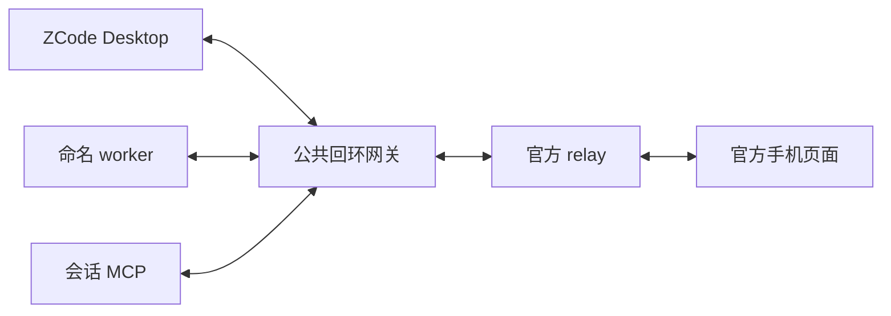

# suian-zcode-common

**业务插件共用的基础能力**：网关、远控协议与探活、DPAPI、Toast、消息投影、原生 UI 能力判定和依赖完整性检查。命名插件保留命名规则，MCP 与侧栏编辑器保留各自业务和数据。公共层不依赖任何插件。

公共层由业务插件自动依赖安装。Agent 会话结束时会检查插件依赖，缺失时通过 Windows 通知提供可复制的修复说明。文本编辑不需要启动远控网关，选区评论另需已有连接。

网关与 Toast 执行器部署在插件缓存之外，插件缓存清理后仍保留稳定启动入口。诊断按发布文件摘要与公共 API 检查；安装记录不可用时明确报告检查未完成。升级与旧链接迁移见 [setup](./skills/setup/SKILL.md)。

版本与兼容范围以[实际发布页面](https://github.com/ONEGAYI/ZCode-Plugins/releases)和安装时的反馈信息为准。

安装和升级时，Agent 会按 Desktop 应用版本选择适用的网关协议；日常重载会保留已有协议与用户配置。具体方法与限制见[配置说明](./skills/configuration/SKILL.md)。

只有网关是常驻独立进程，其他模块由调用方按需使用。各插件保留自己的运行数据。



网关只监听本机地址 `127.0.0.1`，通过当前 ZCode 窗口连接官方远控服务。账号身份仍由 ZCode 管理，插件不需要接收手机远控链接。

## 内网机器：只连接本机

local-only 供无法访问官方远控服务的机器连接当前窗口，不提供手机连接。已有安装不会因断网自动切换模式，模型服务仍需各自可达。

让 Agent 按 [setup](./skills/setup/SKILL.md)核对实际安装包并配置 local-only。需要应用补丁时，先保存工作并退出目标安装目录的全部 ZCode 实例，再执行准备好的外部命令，最后通过原快捷方式重开。具体步骤见[操作指南](../suian-zcode-app-mcp/docs/local-only/05-local-only-guide.md)。

本地模式不支持官方手机页面，界面里的二维码不能用于手机连接。模型生成和套餐查询仍需相应服务可达。回到手机共存模式时，用 `Restart -Mode relay`；ZCode 可能重新注册设备，手机链接也可能需要更新。

历史验证范围见[本地模式记录](./docs/local-only-evidence.json)。

当前版本内容见 [CHANGELOG](./CHANGELOG.md)。

## 原生公共插件

本目录是三个业务插件的必需安装依赖，公共实现只保留一份。原生模式提供[setup](./skills/setup/SKILL.md)、[configuration](./skills/configuration/SKILL.md)和[debug](./skills/debug/SKILL.md)；根 SKILL.md 继续供源码兼容入口路由。

原生安装与升级**不需要 npm 或目录链接**：市场交付的发布目录自带全部运行文件，业务经宿主安装记录定位 common 发布目录（PKG-01 契约），安装完整性由 depcheck 按发布清单校验。npm ci 与 link.mjs 仅用于源码开发（见各包 README 的本地开发说明）；从旧源码安装迁移按[setup 的迁移流程](./skills/setup/SKILL.md#旧源码安装迁移)执行，旧 junction 用 legacy-cleanup.mjs 归属核对后清理。原生 Install/Restart 加 -NativePlugin，不再复制全局技能；网关、任务和数据仍沿用原身份与目录。

## 模块与数据归属

<details>
<summary>公共模块与开发接口</summary>

| 模块 | 公共接口与调用方 |
| --- | --- |
| gateway.mjs | `startGateway({relayProtocolVersion:1或2})`：独立 relay 网关；同进程 `bootstrap()`、`close()`；缺省 V1 |
| gateway-client.mjs / remote.mjs | 插件默认 `connectHost()` / `probeHost()`；旧 `connectRemote()` / `probeRemote()` / `startRelay()` 仅保留显式诊断用途 |
| rpc-broker.mjs | 一个本地 Host 桥；客户端 RPC 编号、订阅及手机虚拟桥分流 |
| auth-store.mjs | `saveAuthorization({dataDir,url})`、`loadAuthorization({dataDir})`、`clearAuthorization({dataDir})` |
| title-policy.mjs | MCP 写入、命名插件读取的独立锁定策略；默认在 `~/.zcode/tools/suian-zcode-common/session-titles` |
| project-context.mjs | `readProjectContext({indexDbPath,sessionId,workspacePath,workspaceKey})`：只读会话的项目、执行及附加目录，冻结会话范围优先；侧栏编辑器与 MCP 共用，不改变网关或执行目录 |
| notifications.mjs | `notifyOnce({dataDir,title,message,reasonCode,appId,actionUri})`；保留两小时冷却、跨进程互斥及显示失败结果 |
| notification-action.mjs | `copyPromptAndOpenWorkspace({prompt,dataDir})`：复制调用方提示词后打开用户默认工作区；仅用户点击后执行 |
| notification-install.mjs | `installToastAssets()` / `removeToastAssets()`：接收调用方的 protocol、appId、shortcutName、description、templateFile、homeDir、dataDir；vbs 转发缓存外稳定启动器，卸载只清理本身份 |
| toast-runtime.mjs | 共享 Toast 稳定运行时：执行器部署到 `~/.zcode/tools/suian-zcode-common/toast`（暂存校验后切换活动记录）、调用方身份外置登记、`checkToastRuntime()` 安装检查 |
| toast-executor.mjs | 自包含 Toast 执行器（部署快照，原样分发进发布目录）：common 现场重扫依赖、title 读外置模板与当前安装根，复制修复提示并打开默认工作区；插件缓存整体缺失时仍可用 |
| prerequisites.mjs | `checkRuntime()`：两插件的 Node / 公共依赖检查；传入 sqliteBin 时额外检查 sqlite3 CLI，只读查询内存库 |
| depcheck.mjs | `scanSuianPlugins()`：suian 系列插件发布契约扫描（release.json 逐文件完整性、身份、公共 API 兼容）；纯内置模块，可独立运行 |
| depcheck-hook.mjs | `runDepcheckHook()`：Stop 钩子入口，发布目录缺失或损坏时 Toast 提醒；`--scan-only` 手动复查 |
| depcheck-prompt.mjs | `buildFixPrompt()` / `buildToastMessage()`：依赖缺失时的修复提示词与提醒文案（修复路径为原生重装/更新） |
| migration.mjs | `captureLegacyState()` / `restoreLegacyState()`：旧源码迁移的开关与路径记录、迁移后恢复；记录不含凭据 |
| legacy-cleanup.mjs | `inspectLegacyLinks()` / `cleanupLegacyLinks()`：旧 runtime/业务端 junction 的归属核对与只删链接清理；`--inspect` 出计划，`--apply` 执行 |
| toast-action.mjs | `runAction()`：Toast 按钮协议入口（缓存内调试直调），重扫后复制修复提示词并打开 ZCode；部署链走缓存外公共执行器 |
| ui-capabilities.mjs | `supportsZcodeMcpApps({clientInfo,capabilities,zcodeAppVersion})`：ZCode 应用版本与 MCP Apps MIME 判定；`MCP_APP_MIME_TYPE` 为页面 MIME 常量 |
| link.mjs | `linkCommon()`：源码开发用的稳定公共入口和业务端 Node 包链接，不复制代码或覆盖普通目录；正式安装与诊断不依赖它 |
| vendor/projection.js | `getConversationMessageProjectionPolicy()`：两个插件引用同一固定产物 |

UI 判定要求客户端名为 `zcode`、宿主支持 MCP Apps，且其 `mimeTypes` 数组包含 `text/html;profile=mcp-app`。公共模块只返回布尔值，资源和工具注册仍归业务插件。

调用方提供 Desktop 的 `zcodeAppVersion`；仅为 `null` 或 `undefined` 时回退客户端版本，未知版本、空字符串或旧版应用均不启用 UI。支持原有三段版本、可选的第四段构建号与 `+` 构建信息，不接受预发布版本。

调用方继续指定自己的数据目录和通知身份。既有授权密文保留，但插件的默认调用不再读取它；Toast 冷却、`suian-zcode-title://` 协议和 AUMID 不迁移。MCP 两个读取工具共享投影库，其余原 Host 调用与命名 worker 共享网关 RPC。会话命名策略保存在公共目录，通知状态仍归调用方。

`connectHost` 的 `listen(channel,event,args)` 保留官方直接对象参数及事件监听与 dispose 语义。固定协议库的来源见[清单](vendor/conversation-wire.sources.json)，许可见[第三方声明](vendor/NOTICE.md)。

</details>

## Agent 配置入口

**安装器按 Desktop 应用版本自动选择协议**。宿主提供 `ZCODE_APP_VERSION` 时可直接读取；在外部 Shell 中执行时，用 `-ZcodeAppVersion` 指定已核实的应用版本。下面的版本占位符需替换为安装时核实的实际值。

读取 [SKILL.md](./SKILL.md)，按完整流程操作。原生安装需要 Windows 和满足安装要求的 Node.js，无需 npm；发布完整性先跑 `node depcheck-hook.mjs --scan-only`：

```powershell
node .\depcheck-hook.mjs --scan-only
powershell.exe -NoProfile -NonInteractive -ExecutionPolicy Bypass -File .\setup.ps1 -Action Status -ZcodeAppVersion "{{zcode_app_version}}" -NativePlugin
powershell.exe -NoProfile -NonInteractive -ExecutionPolicy Bypass -File .\setup.ps1 -Action Install -ZcodeAppVersion "{{zcode_app_version}}" -NativePlugin
```

源码开发先执行 `npm ci --ignore-scripts --no-audit --no-fund`（按锁文件安装依赖），调试用入口不加 -NativePlugin。

Install 通过 `wscript.exe` 的 VBS 启动桥立即启动当前用户的登录任务，验证健康接口后写用户级 `ZCODE_WEB_REMOTE_CONTROL_RELAY_WS_URL`，并广播环境变更，默认 `ws://127.0.0.1:17329/ws`。默认数据目录 `~/.zcode/tools/suian-zcode-gateway` 由两个插件共用，路径为兼容旧安装保留；公共 skill 现在部署到 `~/.zcode/skills/suian-zcode-common`。重复安装复用运行中的实例和原始环境备份。

**先完成安装或升级，最后才安排应用重启**。Agent 留在当前 ZCode 会话里完成源码、依赖、插件配置和本机检查；首次接入或修改启动地址也遵循这个顺序。该变量在 Desktop 主进程启动时读取，因此这两种情况需要用户在配置完成后择时重开，连接验证留到重开后继续。放在 Hook 或 MCP 子进程的环境中无法切换 Desktop。具体启动命令与验证方法统一见 [公共 skill](./SKILL.md)。

Install 可指定 `-Port {{port}}`、`-UpstreamUrl {{relay_url}}` 和 `-RelayProtocolVersion`。协议与官方地址由安装器按实际宿主版本选择；协议与已知应用版本或官方地址冲突时明确报错。没有应用版本信息时，已有安装保留协议，首次安装沿用 V1 默认值并报告 `protocol_source:legacy_default`，不能据此确认适合当前宿主。Install 遇到不同运行配置时要求使用 Restart，不切断已有远控。

更新常驻代码或迁移旧目录时，用 `setup.ps1 -Action Restart` 重载，应用与当前会话保留。脚本先以切换事务锁防止并发升级，再按忙退避等待远控空闲（V2 空闲即闪断、Desktop 连接层自动重连；旧连接保守等待断开窗口），等待旧网关和启动器实际退出后才更新同一任务；未指定协议变更时保留协议、端口、自定义上游、控制令牌和原环境备份。应用升级后，传入核实的实际版本，脚本会按需迁移已知官方地址；原配置为 local-only 时还需明确加 `-Mode relay`。

更换端口用 Restart 的 `-Port {{port}}`，先停旧端口实例再启动新端口。地址未变且原窗口已连接正确网关时，重新开启远控即可；仅更新文档、skill 或业务配置，无需重载网关。

VBS 使用 `Run(..., 0, True)` 隐藏 PowerShell，并等待子进程、返回真实退出码；PowerShell 再等待隐藏 Node。这使任务保持运行，并保留非零退出后每分钟重试、最多三次的设置。运行用 `gateway-launch.vbs` 部署在公共数据目录，避免让常驻 WScript 使用 Git 工作树中的模板。当前版本的模板为 `run.vbs`。

Remove 只在用户要求移除公共网关时执行，先完整退出 ZCode。它通过本工具的本地令牌让 Node 网关自行退出，恢复安装前的用户环境并广播变更，再清理任务与文件；如果变量已被外部修改，则保留外部值且不广播。单独卸载任一插件不移除公共网关。

## 健康状态与本地接口

`setup.ps1 -Action Status` 汇报配置、用户环境、启动任务、Desktop、上游与配对状态。`gateway_running` 来自实际 HTTP 健康结果，`task_running` 单独报告计划任务状态；任务 Ready 不代表 Node 已停止。`gateway_running` 不等于远控已经开启；`desktop_connected` 才能证明有 Desktop 连接网关。默认 HTTP 健康地址为 `http://127.0.0.1:17329/health`。

健康请求默认每次等 5 秒，仅超时时重试一次；需要调整时使用 `-HealthTimeoutSec {{seconds}}`（1–30）。`health_status` 区分未配置、可达和连接失败（`not_configured` / `reachable` / `unreachable`）。连续超时明确报运行状态未知，不输出一个成功的 `gateway_running:false` 来代替；其他错误照实报出。移除与重载直接检查网关，不依赖任务是否 Running；停止后须等 HTTP 监听与旧启动器都结束才改配置。

**Status 会比较运行代码与当前安装代码**。网关在启动时固定代码指纹；更新文件后，运行中的健康接口仍报告原指纹。Status 同时核对安装目录、任务参数与 VBS 内容，只修改文档、skill 或业务配置不会改变网关代码指纹。旧网关没有指纹时，`code_status` 为 `unknown`，需要重载后才能确认代码版本；健康接口的 `version:1` 是协议版本，不能代替插件版本。

| 字段 | 含义 |
| --- | --- |
| `code_status` | `current` 表示指纹相同，`changed` 表示代码已变化，`unknown` 表示旧网关未提供指纹；另有 `unreachable`、`not_configured` |
| `running_build` / `expected_build` | 运行时与当前文件的指纹、目录及插件版本 |
| `relay_protocol_version` / `running_relay_protocol_version` | 本次要求的协议与健康接口报告的实际协议；旧健康接口没有协议字段时按 V1 读取 |
| `protocol_source` | 协议来自应用版本、显式参数、已有配置或旧版默认值；分别为 `desktop_version`、`parameter`、`installed_config`、`legacy_default` |
| `protocol_update_required` / `upstream_update_required` | 已配置或正在运行的协议、已配置上游与本次要求不匹配，需要安全重载 |
| `gateway_restart_required` | 网关需要启动或重载，包括代码、安装目录、启动链不匹配的情况 |
| `launcher_update_required` | 任务入口、参数、VBS 内容需要更新，或任务未运行 |
| `desktop_restart_required` | 用户环境与目标网关地址不同，配置完成后需重开 Desktop；false 不证明已运行应用继承了最新环境 |
| `desktop_connection_required` | Desktop 尚未连接网关，需结合远控面板检查；单凭未连接不能断言必须重开应用 |
| `restart_required` | 上述网关、Desktop 环境或连接事项的汇总标志，不能据此一律要求退出应用 |

`vbs_launcher` 只表示任务使用 VBS，不保证脚本路径正确。需要重载时直接执行 Restart：脚本等待远控空闲后切换，Desktop 连接层自动重连，当前会话保留；完成后再次检查 Status。

| 接口 | 范围 |
| --- | --- |
| WebSocket `/ws` | 一个 Desktop；认证及非 RPC 流量转发，RPC 桥由网关分流；第二个 Desktop 被拒绝 |
| WebSocket `/rpc` | 当前用户插件的本地二进制 Channel RPC；Bearer 鉴权，不新增官方 terminal |
| GET `/health` | 工具版本、安装标识、上游地址、连接与配对布尔值及 `rpc_in_flight`（请求在飞计数，订阅不计）；不含凭据或消息正文 |
| POST `/shutdown` | 仅供公共移除与重载流程，要求本地 Bearer 令牌，且无 Desktop 连接；不是 ZCode 远控 RPC。带 `?idle=1` 的升级关闭：Desktop 在连但无飞行操作时放行闪断，忙时 409 busy |

带浏览器 `Origin` 的 HTTP 或 WebSocket 连接均拒绝。`config.json` 中的 `control_token` 用于本地 RPC 和停止接口；客户端从同一用户的文件读取，令牌只经本地请求头传递。它不是手机远控链接，不要把完整配置、令牌或请求头贴入报告和日志。

Status 的 `rpc_available` 表示已加载 RPC 代码；false 时先按 skill 重载，插件会明确失败，不回退到官方直连。`upstream_paired` 只描述官方链路，`local_clients` 为本地客户端数；`paired` 包含本地虚拟配对，不能证明手机在线。自定义配置目录用 connectHost 的 gatewayConfigPath、命名配置同名字段和 MCP 的 --gateway-config 指向同一个文件。

前台调试可使用 `node gateway.mjs --port 17329`；正式任务由 VBS 隐藏启动 `run.ps1`，读取公共配置。不要同时开第二个实例，不要在两个插件各自 `.local` 建另一套公共配置。

## 更新文件与重新启动

**更新代码不会自动重载运行中的网关**。网关代码更新后，需要按公共 skill 执行 Restart 才能生效；只更新文档、skill 或业务配置时无需重载网关。

网关持续写入的日志在上述数据目录，源码目录不承担运行日志。新公共层保持旧网关的任务名和健康 `service:suian-zcode-gateway`，避免创建第二个后台进程。目录改名后启动任务的脚本路径需要由 Restart 更新，不能只执行 Git 更新就宣称升级完成。

**配置完成后，优先从桌面或开始菜单重开 ZCode**。脚本会广播环境变更，让 Explorer 等启动器收到更新通知，通常无需注销账户或重启 Windows。已运行的 ZCode 和终端不会因此自动更新；仍传入旧变量的启动器才需要按公共 skill 显式读取变量再启动。生效后检查实际连接，不要求以后永远从 PowerShell 打开。

安装、重载或恢复环境后，`environment_broadcast:sent` 表示已向启动器发送环境更新通知。已运行的应用仍需按上述条件重新打开，广播结果不能代替实际连接检查。

## 使用限制与开发记录

手机控制本机项目时，可以与插件同时使用。手机正在控制 SSH、WSL 等远程开发工作区时，本地插件的会话控制暂不可用；已有本地调用未结束时，手机也不能切换到远程开发工作区。

3.16 的在线共存、核心会话操作和后台生成标题已通过验证。每轮对话结束后自动触发命名的完整流程，以及侧栏编辑器的选区评论，尚未完成 3.16 验证。

网关依赖 ZCode 处理官方连接中断后的重连，尚未完成长期高负载验证。

协议适配、实验过程和分项证据见[3.16 开发验证记录](../suian-zcode-app-mcp/docs/zcode-3.16-gateway-validation.md)。旧版共存记录见[共存验证](../suian-zcode-app-mcp/docs/relay-gateway-coexistence.md)，安装与升级记录见[配置验证](./docs/setup-evidence.json)和[公共层验证](./docs/common-layer-evidence.json)。

<details>
<summary>Windows 启动实现依据</summary>

Windows 任务参数依据 [Register-ScheduledTask](https://learn.microsoft.com/en-us/powershell/module/scheduledtasks/register-scheduledtask)、[任务身份](https://learn.microsoft.com/en-us/powershell/module/scheduledtasks/new-scheduledtaskprincipal) 和 [任务设置](https://learn.microsoft.com/en-us/powershell/module/scheduledtasks/new-scheduledtasksettingsset)。采用 Interactive/Limited 当前用户身份，不保存账户密码。任务在登录触发之外带每 30 分钟（`-KeepaliveIntervalMin` 可配 5-1440）的周期看护触发，配合 `MultipleInstances IgnoreNew` 与启动器健康门保证幂等拉起；进程存活但不监听的僵尸场景不在自动看护范围。VBS 使用批处理模式避免脚本错误弹窗，入口参数见 [wscript](https://learn.microsoft.com/en-us/windows-server/administration/windows-commands/wscript)。健康超时参数见 [Invoke-RestMethod](https://learn.microsoft.com/en-us/powershell/module/microsoft.powershell.utility/invoke-restmethod?view=powershell-5.1)。停止时让 Node 自行退出并等待启动链结束，避免只停止外层启动器：[Start-Process](https://learn.microsoft.com/en-us/powershell/module/microsoft.powershell.management/start-process)。

</details>

自有代码沿用仓库 [MIT 许可](../LICENSE)。固定协议与消息投影库的来源和 Apache-2.0 许可见 [vendor/NOTICE.md](./vendor/NOTICE.md)。
